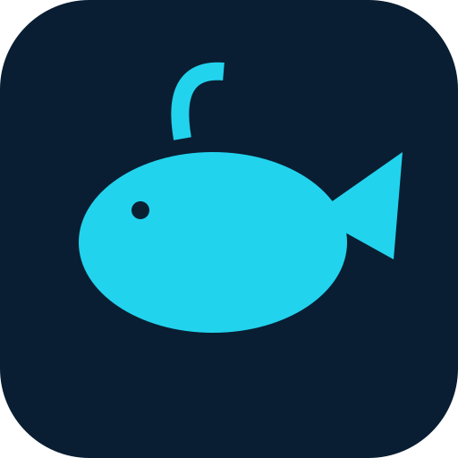

# WhaleCodex 1.2.0

[](LICENSE)

A CI template is provided in [docs/ci-workflow.yml.example](docs/ci-workflow.yml.example). GitHub Actions is not enabled; release checks were run locally.

<p align="center"></p>

An Electron desktop workspace for model conversations, coding tasks and task outputs.

Repository: https://github.com/meteor03112/WhaleCodex
Releases: https://github.com/meteor03112/WhaleCodex/releases
Full Chinese documentation: [README.md](README.md).

Version 1.2.0 is available as readable source. Configure your own model provider and supply compatible external Codex / whisper runtimes when needed. Network requests and API costs depend on configured services. No telemetry-free or trusted-signing claim is made.

```sh
npm install
npm run check
npm test
npm start
npm run build -- --win --x64
npm run build -- --linux --arm64
```

Builds work without bundled external engines, producing an application shell. Set `WHALE_EXTERNAL_RESOURCES` to a directory containing `engine/` and optional `whisper/` to include compatible legally redistributable runtimes. Never reuse an old app.asar. See the Chinese README for layouts and build overrides.

Windows is the primary desktop target. Linux needs matching actual binary architectures and system libraries. macOS has basic build configuration but has not passed device acceptance. D1 semantic desktop control is Windows-specific, **off by default and awaiting acceptance**; the separately supplied helper must match pinned checks. F1 attachment cards exist, but **dragging into a target application has not been accepted**.

Independent application code, documentation and the newly drawn geometric logo are licensed under Apache-2.0. Third-party licenses remain separate. The optional whale-fantasy theme is CC BY-NC-SA 4.0, disabled and excluded from default builds; upstream media/previews are omitted. See [NOTICE](NOTICE), [LICENSE](LICENSE), [SECURITY.md](SECURITY.md) and [CONTRIBUTING.md](CONTRIBUTING.md).
