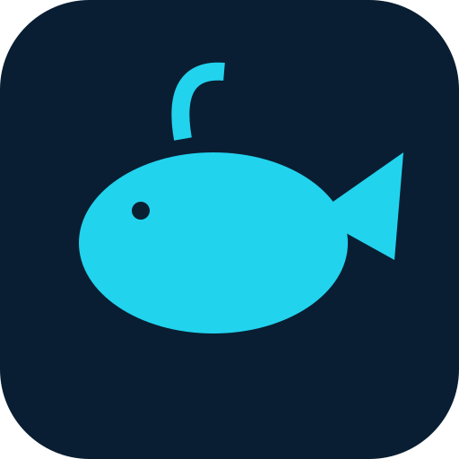

# WhaleCodex 1.2.0

[](LICENSE)

CI 模板位于 [docs/ci-workflow.yml.example](docs/ci-workflow.yml.example)，当前未启用 GitHub Actions；本次发布已在本机运行语法和模块回归检查。
[](LICENSE)

<p align="center"></p>

把模型对话、编程任务和任务产物放在同一个桌面工作台。

WhaleCodex 是基于 Electron 的桌面客户端，提供多模型对话、Codex 引擎接入、上下文管理、子任务编排与工作台。你可以配置自己的模型服务，在对话中查看推理与工具活动、整理附件，并把任务结果留在本地工作目录。模型服务、账号、API 费用与外部引擎需自行提供。

- 源码仓库：[meteor03112/WhaleCodex](https://github.com/meteor03112/WhaleCodex)
- 下载与版本记录：[Releases](https://github.com/meteor03112/WhaleCodex/releases)
- 问题反馈：[Issues](https://github.com/meteor03112/WhaleCodex/issues)
- English: [README.en.md](README.en.md)

**1.2.0 现以可读源码开放。** 主程序直接使用可读 JavaScript，不执行混淆构建。发布包的实际可用性以各平台验收记录为准。

## 下载 1.2.0

前往 **[最新 Release](https://github.com/meteor03112/WhaleCodex/releases/latest)**：Windows x64 安装版/便携版，以及 Linux ARM64 实验 tar 包。Windows 已使用原发布者自签证书签名并附时间戳；Linux 与 Windows 下载包均提供 GPG 分离签名和签名校验和清单。**自签名不等于系统信任的 CA 证书；Linux ARM64 尚未实机运行验收。** 详细签名核验、Linux 依赖和功能边界见 [1.2.0 发布说明](docs/RELEASE-NOTES-1.2.0.md)。

GPG 指纹：`6F84E4E00F86FD100CA94FEDF63AE65454CC2288`。

## 能做什么

| 功能 | 源码状态与边界 |
| --- | --- |
| 多模型对话 | 含服务提供商配置、模型选择、Chat / Responses 协议适配；受服务端模型能力、鉴权和配额影响 |
| 编程 Agent | 通过外部 Codex 可执行程序运行，需要匹配平台的引擎及其配套资源；仓库不包含引擎二进制 |
| 上下文与用量 | 含预算、规划、摘要及用量归一化；缺失数据按不可用处理，不保证所有提供商都返回完整指标 |
| 子任务编排 | 含运行注册、子任务编排和进度展示代码；并发和工具能力由引擎与模型决定 |
| 工作台 | 含网页、文件和任务结果相关界面；具体操作受平台、网络和文件权限限制 |
| 连接器 / MCP | 含配置入口与服务适配；许多连接器需要第三方服务、令牌或自建网关，列出入口不等于已通过逐项集成验收 |
| 本地语音输入 | 需要外部 whisper-server 与模型；模型管理包含 HTTPS 下载、签名与摘要校验代码；服务源可用性未承诺 |
| D1 桌面语义桥 | **待验收，默认关闭**（`desktopControl=false`）；仅面向 Windows 的匹配 helper，受版本、hash、窗口白名单和授权限制；不宣称任意桌面控制 |
| F1 回复附件 | 含受控附件登记、卡片及 IPC 代码；**向目标应用拖入文件的行为尚未验收**，不能据此承诺跨应用拖放完成 |
| 可选 whale-fantasy 主题 | 默认不启用、不打入构建。适配代码与上游许可保留在独立目录，采用 CC BY-NC-SA 4.0；视频及预览图不分发 |

## 平台差异

| 平台 | 构建入口 | 当前边界 |
| --- | --- | --- |
| Windows x64 | `npm run build:win` | 主要桌面目标；引擎与 whisper 必须为 Windows x64。D1 helper 为额外可选组件，尚待验收 |
| Linux | `npm run build:linux -- --x64` 或 `--arm64` | 必须匹配 Electron、Codex、whisper 的真实架构；不可仅依据目录名判断 ELF 架构。桌面语义桥不适用，系统依赖和沙箱策略需目标机测试 |
| macOS | `npm run build:mac` | 提供基础构建配置，尚未完成实机验收；需自行提供对应架构引擎及语音资源，并处理 Apple 平台权限、签名与公证 |

构建成功不等于功能验收。仓库不承诺跨平台等价行为或受操作系统信任的签名。任何自签名证书均不等同于受信任 CA 证书。

## 本地开发

推荐 Node.js 22 或更新的受支持版本、npm，以及 Electron 所需系统库。应用固定使用 Electron 45.2.2 和 electron-builder 26.18.0。

```bash
npm install
npm run check
npm test
npm start
```

开发数据默认写入 Electron 的 `userData`，可通过 `WHALE_ROOT` 覆盖。不要把设置、聊天、会话、访问令牌或日志放进仓库。初次使用请在设置中配置自己的服务。API 服务会接收你发送的内容；连接器、网页、模型下载及引擎也可能访问网络。`telemetry.js` 用于统一用量与速度指标，本项目不作“无遥测”保证，请审查实际代码与服务隐私政策。

未提供引擎时，界面和部分服务配置仍可开发，但依赖 Codex 的任务会提示引擎缺失。语音缺少 whisper 时不能使用。不要从旧安装包复制 `app.asar` 来代替本仓库源码。

## 构建与外部运行时

```bash
npm run build -- --win --x64
npm run build -- --linux --arm64
npm run build -- --mac --arm64
# 只生成解包目录
npm run build -- --win --x64 --dir
```

默认构建不要求外部二进制存在，产物为应用壳。需要完整运行功能时，显式设置 `WHALE_EXTERNAL_RESOURCES`，其内容遵循以下结构：

```text
external-resources/
  engine/
    codex.exe                  # Windows；Linux/macOS 为 codex
    codex-resources/            # 若所选引擎要求，保留原配套结构
    # 或 engine/vendor/<target-triple>/bin/codex 与同级配套文件
  whisper/
    whisper-server.exe         # Windows；Linux/macOS 无 .exe
    ...                        # 对应动态库与合法分发的模型（可选）
```

PowerShell 示例：

```powershell
$env:WHALE_EXTERNAL_RESOURCES = (Resolve-Path './external-resources').Path
npm run build -- --win --x64
```

构建脚本只从指定目录复制 `engine` 与 `whisper`，不会自动寻找开发机的运行时。开发启动也使用该变量，未设置时使用仓库根部的 `external-resources`。打包运行从 Electron 的 `resources/engine` 和 `resources/whisper` 读取。`WHALE_BUILD_OUTPUT` 可设置输出目录，`WHALE_ELECTRON_DIST` 可使用预先取得的 Electron 目录；这些路径由调用者提供，不写入公开配置。

D1 helper 不随仓库或默认构建分发。Windows 上单独准备具有合法许可、与源码固定版本/hash匹配的 helper，通过 `WHALE_DESKTOP_HELPER` 指定；打包默认候选为 `resources/desktop/agent-desktop.exe`。开启前需完成权限、窗口白名单与动作结果验收。不要为了运行未知 helper 删除校验。

外部 Codex、whisper、模型和动态库按各自许可证分发；自行核对依赖与架构。构建工具可能需要联网下载 Electron、打包工具或系统依赖。跨平台安装器、Linux deb 系统依赖及 macOS 签名/公证需适配构建环境。各平台的完整功能验收情况以发布说明为准，尚未验收的功能请参照上方矩阵。

## 目录与许可证

```text
app/                 可读主进程、渲染器、桥接与前端资源
app/vendor/licenses/ 内置前端库许可
app/themes/          默认禁用的非商业可选主题及其上游许可
assets/              本次绘制的几何鲸鱼 logo、应用图标
scripts/             语法检查与可选运行时构建脚本
tests/               附件存储、IPC、下载与边界测试（含显式 Electron/DOM 替身）
docs/                公开准备审计与发布文案
```

WhaleCodex 独立主代码、文档及本次原创几何 logo 采用 [Apache-2.0](LICENSE)，版权与组件说明见 [NOTICE](NOTICE)。**该许可不覆盖第三方组件与非商业主题。** `app/themes/whale-fantasy` 保留上游 CC BY-NC-SA 4.0 许可及来源，不能将其标成 Apache-2.0；需要商业用途时请移除该目录或取得相应权利。默认构建已经排除主题目录。公开 logo 不使用用户截图、上游主题人物或来源不明的品牌图片；连接器图标采用本次生成的文字标识，不表示第三方背书。

内置 marked、DOMPurify、highlight.js、OpenCC 转换代码按其各自许可使用，详见 `app/vendor/licenses`。签名验证所需的公钥可以公开；仓库不包含签名私钥。安全问题参见 [SECURITY.md](SECURITY.md)，贡献方式参见 [CONTRIBUTING.md](CONTRIBUTING.md)，变更记录见 [CHANGELOG.md](CHANGELOG.md)。
